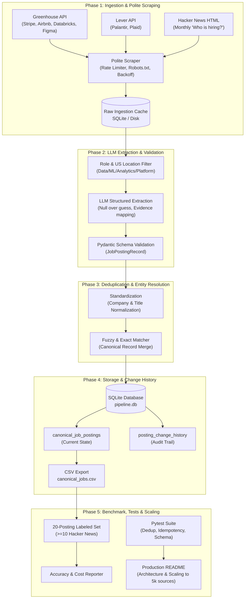

# Twig Data Engineer Take-Home: Five-Phase Implementation Plan

## Executive Summary
This document outlines the end-to-end architecture and five-phase implementation strategy for the **Twig Data Engineer Take-Home Assignment**. The goal is to build a production-minded Python pipeline that scrapes job postings from Greenhouse, Lever, and Hacker News, extracts clean structured records with an LLM adhering to a strict Pydantic schema, deduplicates records across sources, maintains change history across idempotent re-runs, and benchmarks accuracy on a labeled evaluation set.

---

## Architecture Overview



---

## Detailed Phase Breakdown

Click into each detailed phase plan below:

| Phase | Title | Focus & Core Responsibilities | Specification Link |
|---|---|---|---|
| **Phase 1** | **Ingestion & Polite Scraping** | Greenhouse API, Lever API, and Hacker News HTML crawling with pagination. Rate limiting (max 1 req/s), robots.txt compliance, retry backoff, and raw caching. | [Phase 1 Specification](file:///d:/Project_Files/AGY_Assignments/Twig/Plan/Phase_1_Ingestion_and_Scraping.md) |
| **Phase 2** | **LLM Extraction & Validation** | Strict Pydantic model validation. Zero guessing (null over guess), verbatim source text snippets for `evidence`, cost-effective prompt design and token logging. | [Phase 2 Specification](file:///d:/Project_Files/AGY_Assignments/Twig/Plan/Phase_2_LLM_Extraction_and_Validation.md) |
| **Phase 3** | **Deduplication & Entity Resolution** | Cross-source entity matching across ATS feeds and HN comments. Seniority disambiguation, company normalization, and merging into canonical records with full source link history. | [Phase 3 Specification](file:///d:/Project_Files/AGY_Assignments/Twig/Plan/Phase_3_Deduplication_and_Entity_Resolution.md) |
| **Phase 4** | **Storage, Idempotency & Change History** | SQLite database schema with `raw_ingestion_cache`, `canonical_job_postings`, and `posting_change_history`. Idempotent re-runs, job closure detection, and CSV export. | [Phase 4 Specification](file:///d:/Project_Files/AGY_Assignments/Twig/Plan/Phase_4_Storage_Idempotency_and_Change_History.md) |
| **Phase 5** | **Evaluation, Benchmark, Tests & README** | 20 hand-labeled postings benchmark (>=10 HN), field-level accuracy and LLM cost reporting, pytest test suite, and 1-page scaling architecture README. | [Phase 5 Specification](file:///d:/Project_Files/AGY_Assignments/Twig/Plan/Phase_5_Evaluation_Testing_and_Documentation.md) |

---

## Target Project Structure (inside `Twig/Code`)

```
Twig/
├── Plan/
│   ├── Five_Phase_Implementation_Plan.md
│   ├── Phase_1_Ingestion_and_Scraping.md
│   ├── Phase_2_LLM_Extraction_and_Validation.md
│   ├── Phase_3_Deduplication_and_Entity_Resolution.md
│   ├── Phase_4_Storage_Idempotency_and_Change_History.md
│   └── Phase_5_Evaluation_Testing_and_Documentation.md
├── Task/
│   ├── Data Engineer Take-Home Assignment.pdf
│   └── Data Engineer Take-Home Assignment_2.pdf
└── Code/
    ├── pipeline/
    │   ├── __init__.py
    │   ├── __main__.py          # Entrypoint (python -m pipeline run)
    │   ├── config.py            # Target companies, sources, rates
    │   ├── scrapers/
    │   │   ├── __init__.py
    │   │   ├── base.py          # Polite scraper, rate limiter, retry
    │   │   ├── greenhouse.py
    │   │   ├── lever.py
    │   │   └── hackernews.py
    │   ├── models/
    │   │   ├── __init__.py
    │   │   └── schema.py        # Pydantic schemas and enums
    │   ├── extractor/
    │   │   ├── __init__.py
    │   │   ├── llm_client.py    # LLM structured prompt and cost tracking
    │   │   └── prompt.py
    │   ├── dedup/
    │   │   ├── __init__.py
    │   │   └── resolver.py      # Fuzzy & exact matching, canonical merge
    │   ├── storage/
    │   │   ├── __init__.py
    │   │   ├── database.py      # SQLite connection & migrations
    │   │   ├── repository.py    # Idempotent upserts, change history
    │   │   └── exporter.py      # CSV export
    │   └── evaluate/
    │       ├── __init__.py
    │       └── benchmark.py     # Accuracy and token cost calculation
    ├── data/
    │   ├── pipeline.db          # Local SQLite database
    │   ├── canonical_jobs.csv   # Final output export
    │   └── labeled_benchmark.json # 20 hand-labeled postings
    ├── tests/
    │   ├── test_scrapers.py
    │   ├── test_schema.py
    │   ├── test_dedup.py
    │   └── test_idempotency.py
    ├── requirements.txt
    ├── Makefile                 # make run, make test, make evaluate
    └── README.md                # 1-page architecture, trade-offs, scaling
```

---

## Evaluation Rubric Alignment

| Rubric Area | Weight | How Our Implementation Delivers Strong Signal |
|---|---|---|
| **Pipeline Design** | 25% | Fully modular stages, raw caching, idempotent re-runs, and dedicated change history tracking. |
| **LLM Extraction** | 20% | Strict Pydantic models, verified evidence snippets per field, strict nulls for unstated values, pre-filtering before LLM. |
| **Scraping Robustness** | 20% | Domain-level rate limiting (<= 1 req/s), robots.txt adherence, exponential backoff, Lever content-type verification, and graceful error logging. |
| **Dedup & Data Quality** | 15% | High-precision normalization and blocking, clear conflict resolution rules, cross-source link retention, and comprehensive edge-case tests. |
| **Code Quality & Tests** | 10% | Fully typed, structured modules with pytest tests covering deduplication, schema validation, and change detection. |
| **README & Scaling** | 10% | Concrete cost measurements, explicit trade-off analyses, identified failure points, and a practical 5,000-source scaling design. |
