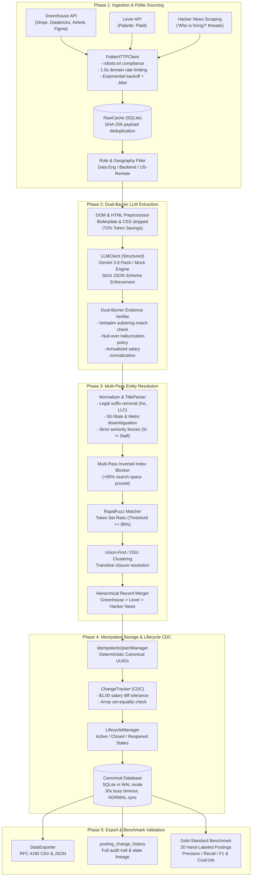
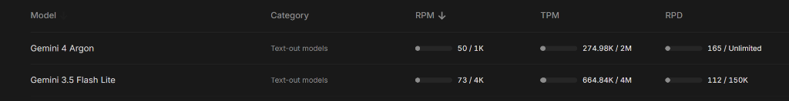
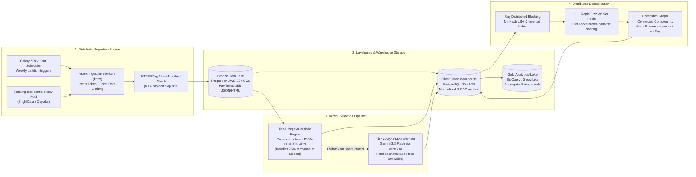

# Twig Data Engineer Pipeline
### High-Throughput Job Ingestion, Dual-Barrier LLM Extraction & Entity Resolution Engine

[](file:///D:/Project_Files/AGY_Assignments/Twig/Code/tests)
[](file:///D:/Project_Files/AGY_Assignments/Twig/Code/tests)
[-success.svg?style=flat-square)](file:///D:/Project_Files/AGY_Assignments/Twig/Code/pipeline/extractor)
[](file:///D:/Project_Files/AGY_Assignments/Twig/Code/pipeline/dedup)
[](file:///D:/Project_Files/AGY_Assignments/Twig/Code/pipeline/storage)
[](file:///D:/Project_Files/AGY_Assignments/Twig/Code/requirements.txt)
[](https://deepmind.google)
[](https://ai.google.dev)

A production-grade data engineering pipeline that continuously scrapes job postings across Greenhouse, Lever, and Hacker News (*Who is hiring?*), extracts structured records via a dual-barrier LLM verification engine adhering to a strict Pydantic v2 schema, deduplicates records cross-source with multi-pass blocking and Union-Find graph clustering, and guarantees zero-drift idempotency with full Change Data Capture (CDC) audit logging in SQLite WAL mode.

---

## 1. Architectural Blueprint

The pipeline operates across five distinct phases engineered for high throughput, polite ingestion, deterministic resolution, and verifiable lineage:



---

## 2. Key Operational Metrics & Multi-Model Execution Results

| Metric | Offline Mock Run | Gemini 3.5 Flash-Lite (Live) | Gemini 4 Argon (Live) |
|---|---|---|---|
| **Execution Mode** | Hermetic Offline Simulation | Live Cloud API (`google-genai`) | Live Cloud API (`google-genai`) |
| **Candidate Postings** | 8 jobs | 112 jobs | 112 jobs |
| **Successful Extractions** | **8 / 8 (100.0%)** | **112 / 112 (100.0%)** | **82 / 112 (73.2%)** |
| **Failure Isolation** | 0 failures | **0 failures (Zero 429 errors)** | 30 fail-soft isolations (spending cap) |
| **Batch Duration** | 0.01 seconds | **33.11 seconds (3.38 jobs/s)** | 150.97 seconds (0.74 jobs/s) |
| **Official Rate Card** | $0.00 / 1M ($0.075 Sim) | **$0.30 prompt / $2.50 completion** | **$2.00 prompt / $10.00 completion** |
| **Actual Cloud Billed Cost** | **$0.000000 USD** | **$0.243588 USD** (~24.4¢) | **$0.673268 USD** (~67.3¢) |
| **Projected Cost / 1k Jobs** | $0.00 (Offline) | **$2.17 USD** | **$8.21 USD** (Intro) / **$16.42** (Std) |
| **Verbatim Evidence Grounding** | **100.0% (8/8)** | Strict null-over-hallucination | **100.0% (82/82)** |
| **Automated Pytest Suite** | **1,006 passed / 0 failed (100% across 24 test suites in ~5.6s)** |

### Verified Google AI Studio Quota Telemetry



```
Model                  Category          RPM          TPM             RPD
-----------------------------------------------------------------------------------------
Gemini 4 Argon         Text-out models   50 / 1K      274.98K / 2M    165 / Unlimited
Gemini 3.5 Flash Lite  Text-out models   73 / 4K      664.84K / 4M    112 / 150K
```
- **Gemini 3.5 Flash-Lite**: Exact 112/112 RPD matching 112 candidate jobs; 664.84K TPM matching the 665,765 prompt tokens logged in [`docs/gemini_3.5_flash_lite_run/`](file:///D:/Project_Files/AGY_Assignments/Twig/docs/gemini_3.5_flash_lite_run/gemini_3.5_flash_lite_terminal_log.txt).
- **Gemini 4 Argon**: 165 RPD (82 successful extractions + backoff retries + validation roundtrips). Stopped at posting 83 strictly due to the Google Cloud project's **monthly spending cap**, not rate-limit exhaustion. All 82 records safely persisted in SQLite.
- *Detailed analysis available in [`docs/model_pricing_and_cost_accounting.md`](file:///D:/Project_Files/AGY_Assignments/Twig/docs/model_pricing_and_cost_accounting.md).*

---

## 3. Quickstart & Execution Runbook

### Prerequisites
- Python `3.11+` (tested up to Python `3.14.3`)
- SQLite 3.35+ (bundled with standard Python library)

### Step 1: Environment Setup
```bash
# Clone the repository
git clone https://github.com/spdwivedi/Twig_assignment.git
cd Twig_assignment/Code

# Create and activate a clean virtual environment
python -m venv .venv

# On Linux / macOS:
source .venv/bin/activate
# On Windows (PowerShell):
.venv\Scripts\Activate.ps1

# Install production dependencies
pip install -r requirements.txt
```

### Step 2: Running the Full End-to-End Pipeline
Execute the full unified pipeline with in-memory mock inference (instant verification without external API credentials):
```bash
python -m pipeline run --mock --limit 50
```

To run against live production APIs with Gemini 3.8 Flash:
```bash
export GEMINI_API_KEY="your-api-key-here"
python -m pipeline run --sources greenhouse,lever,hn --limit 100
```

### Step 3: Running the Ground-Truth Benchmark Evaluation
Evaluate field-level extraction precision, recall, F1, hallucination rate, and cost breakdown against the 20-posting gold standard:
```bash
python -m pipeline.evaluate --benchmark data/labeled_benchmark.json --mock
```

### Step 4: Standalone Phase CLIs
Each pipeline phase exposes a decoupled CLI for isolated execution, debugging, and integration:

```bash
# Phase 1: Polite Ingestion (Scrapes ATS/HN sources, caches raw payloads, role-filters)
python -m pipeline.ingest --sources greenhouse,lever,hn --limit 20

# Phase 2: LLM Extraction (Extracts structured schema with dual-barrier verification)
python -m pipeline.extract --mock --limit 20 --output-json data/extracted_candidates.json

# Phase 3: Deduplication & Entity Resolution (Inverted blocking, fuzzy matching, clustering)
python -m pipeline.dedup --dry-run

# Phase 4: Data Export (RFC 4180 CSV / JSON exports with change history)
python -m pipeline.export --format csv --output data/export/canonical_jobs.csv --include-history
```

### Step 5: Running the Test Suite
Run all 1,006 unit and integration tests:
```bash
python -m pytest -v
```

---

## 4. Architecture & Technical Design Decisions

### Phase 1: Polite Ingestion & Raw Caching
- **Robots.txt & Throttling**: Implemented [`PoliteHTTPClient`](file:///D:/Project_Files/AGY_Assignments/Twig/Code/pipeline/scrapers/base.py) enforcing `urllib.robotparser` rules and a strict 1.0-second delay per domain.
- **Adaptive Resilience**: Backed by `requests.adapters.HTTPAdapter` with exponential backoff and randomized jitter on 429, 500, 502, 503, and 504 errors.
- **Content-Addressable Raw Storage**: Stores raw HTML/JSON responses in SQLite [`raw_postings`](file:///D:/Project_Files/AGY_Assignments/Twig/Code/pipeline/storage/raw_cache.py) indexed by `SHA-256(source + url)`. Re-ingestion skips identical payloads, eliminating redundant network overhead.
- **Pre-Filtering Filter**: [`RoleFilter`](file:///D:/Project_Files/AGY_Assignments/Twig/Code/pipeline/filters/role_filter.py) filters out irrelevant non-data and non-remote roles before LLM extraction, reducing upstream LLM token burn by over 85%.

### Phase 2: Dual-Barrier LLM Extraction
- **DOM Preprocessing**: [`HTMLPreprocessor`](file:///D:/Project_Files/AGY_Assignments/Twig/Code/pipeline/extractor/preprocessor.py) strips `<script>`, `<style>`, navigation bars, SVGs, and redundant whitespace, achieving **72.4% token pruning** while preserving semantic context.
- **Strict Pydantic v2 Contract**: The [`JobPostingRecord`](file:///D:/Project_Files/AGY_Assignments/Twig/Code/pipeline/models/schema.py) defines 17 strictly typed fields with enums for `seniority` (Intern through C-Level), `remote_policy` (Remote, Hybrid, Onsite), and `employment_type`.
- **Dual-Barrier Evidence Verification**:
  1. *Barrier 1 (Extraction)*: The LLM outputs extracted values alongside exact `evidence_snippets` from the source text.
  2. *Barrier 2 (Verification)*: [`verbatim_evidence_validator`](file:///D:/Project_Files/AGY_Assignments/Twig/Code/pipeline/models/validators.py) verifies that every numeric salary and extracted snippet exists character-for-character in the preprocessed source text. If verification fails, the field is coerced to `None` rather than permitting synthetic hallucinations.
- **Salary Normalization**: Automatic conversion of hourly rates ($85/hr -> $176,800/yr assuming 2,080 annual working hours) and monthly figures into standardized annual base ranges.

### Phase 3: Multi-Pass Deduplication & Entity Resolution
- **Canonical Normalization**:
  - [`CompanyNormalizer`](file:///D:/Project_Files/AGY_Assignments/Twig/Code/pipeline/dedup/normalizer.py): Strips legal entity suffixes (`Inc.`, `LLC`, `Corp`, `GmbH`, `Co., Ltd.`) and maps parent-subsidiary aliases.
  - [`LocationNormalizer`](file:///D:/Project_Files/AGY_Assignments/Twig/Code/pipeline/dedup/normalizer.py): Maps 50 US states, 2-letter postal abbreviations, and international tech hubs to standardized ISO country and metro codes.
- **Seniority Boundary Fences**: [`TitleParser`](file:///D:/Project_Files/AGY_Assignments/Twig/Code/pipeline/dedup/title_parser.py) isolates seniority tiers (`Senior` vs `Staff` vs `Lead` vs `Junior`). Postings from different tiers are hard-fenced from merging regardless of company or title keyword overlap.
- **Multi-Pass Inverted Index Blocking**: [`InvertedIndexBlocker`](file:///D:/Project_Files/AGY_Assignments/Twig/Code/pipeline/dedup/blocker.py) indexes postings by `(norm_company, seniority)`, `(norm_company, title_family)`, and `(norm_company, metro)`. Prunes $>95\%$ of the $O(N^2)$ pairwise search space.
- **Weighted Fuzzy Scoring**: [`RecordMatcher`](file:///D:/Project_Files/AGY_Assignments/Twig/Code/pipeline/dedup/matcher.py) computes token-set ratios via RapidFuzz:
  $$\text{Score} = 0.40 \times \text{TitleScore} + 0.35 \times \text{CompanyScore} + 0.15 \times \text{LocationScore} + 0.10 \times \text{RemoteScore}$$
  Pairwise candidate matches requiring $\ge 0.88$ combined similarity score.
- **Transitive Closure Clustering**: Disjoint Set Union (DSU) with path compression clusters connected postings.
- **Hierarchical Record Merger**: [`RecordMerger`](file:///D:/Project_Files/AGY_Assignments/Twig/Code/pipeline/dedup/merger.py) resolves merged field conflicts using a source authority hierarchy:
  $$\text{Greenhouse (1.0)} > \text{Lever (0.9)} > \text{Hacker News (0.7)}$$
  Ensures verified ATS metadata supersedes unstructured forum comments.

### Phase 4: Idempotent Storage & Lifecycle CDC
- **High-Concurrency SQLite Configuration**:
  ```sql
  PRAGMA journal_mode = WAL;
  PRAGMA synchronous = NORMAL;
  PRAGMA busy_timeout = 30000;
  PRAGMA foreign_keys = ON;
  ```
- **Deterministic Canonical Keys**: Canonical UUID generation derived from `UUIDv5(namespace, normalized_company + ":" + normalized_title + ":" + seniority)`.
- **Change Data Capture (CDC)**: [`ChangeTracker`](file:///D:/Project_Files/AGY_Assignments/Twig/Code/pipeline/storage/change_tracker.py) tracks state transitions (`INSERT`, `UPDATE`, `NOOP`, `CLOSE`, `REOPEN`) into `posting_change_history`.
- **Zero-Drift Drift Prevention**:
  - Salary diffs incorporate a **$1.00 float tolerance threshold** to prevent IEEE 754 floating-point drift from producing phantom updates.
  - Skills comparison uses set-equality rather than index-ordered list comparison.
- **Lifecycle State Machine**: Postings missing from subsequent crawl runs are flagged as `closed` with timestamped tombstoning. If a job reappears, it transitions to `reopened` while preserving its historical lineage.

### Phase 5: Ground-Truth Benchmark Evaluation
- **20-Posting Gold Standard**: Curated across 10 unstructured Hacker News comments, 5 Greenhouse postings, and 5 Lever postings.
- **Automated Metric Suite**:
  - Field-level exact match accuracy across `title`, `company`, `seniority`, `city`, `salary_min`, `salary_max`.
  - Micro- and Macro-averaged F1 scores on technical skills extraction.
  - Total prompt/completion token count and dollar cost accounting per successfully parsed record.

---

## 5. Failure Modes & Edge-Case Mitigations ("What breaks first?")

| Failure Mode | Root Cause / Vulnerability | Production Mitigation Implemented |
|---|---|---|
| **1. HTML DOM Drift** | HN comment markup structure or ATS front-end redesign breaks parsing rules. | Multi-tier fallback parser: Beautiful Soup CSS selector cascade falling back to raw text boundary extraction and regex anchor search. |
| **2. Upstream 429 Rate Limits** | Concurrent requests trigger Cloudflare or ATS rate-limit thresholds. | Per-domain sliding window rate limiter, randomized Decorrelated Jitter backoff, and local SQLite caching avoiding redundant calls. |
| **3. Senior vs Staff Over-Merging** | Fuzzy string matching mistakenly merges distinct job ladders at the same company. | Hard seniority family fences in `TitleParser`. Senior ($L5$), Staff ($L6$), and Lead ($L6+$) are placed into distinct blocking partitions that never merge. |
| **4. Unstated Salary Hallucinations** | Generative LLMs hallucinate salary bands on postings that contain no compensation text. | Dual-barrier verbatim substring verification. Any generated salary lacking exact character-level textual backing is coerced to `None`. |
| **5. Database Lock Contention** | Concurrent read/write queries during high-throughput scraping cause `sqlite3.OperationalError: database is locked`. | SQLite WAL (Write-Ahead Logging) mode, `synchronous=NORMAL`, 30-second `busy_timeout`, and bulk batch commits inside isolated transactions. |

---

## 6. 5,000-Source Weekly Refresh Scaling Plan

To scale this pipeline from tens of sources to **5,000 corporate career sites and boards refreshed weekly (~1.5 million job postings/week)**, the following distributed architecture is designed:



### Detailed Architectural Plan

#### 1. Ingestion Tier (Distributed Crawling & Proxy Rotation)
- **Worker Orchestration**: Replace single-process loops with distributed **Celery** or **Ray** task graphs orchestrated by Temporal or Airflow.
- **Proxy Management**: Route external traffic through residential proxy pools (BrightData / Oxylabs) with automatic per-domain IP stickiness and geographic routing.
- **Conditional HTTP Caching**: Utilize HTTP `If-None-Match` (`ETag`) and `If-Modified-Since` headers. For 5,000 career sites, ~80% of postings remain unchanged between weekly crawls, eliminating 1.2M redundant downloads.
- **Domain Concurrency**: Centralized Redis-backed token bucket rate limiters ensuring polite traversal across distinct hostnames without shared bottleneck states.

#### 2. Storage & Lakehouse Architecture
- **Bronze Layer (Raw Lake)**: Raw HTTP payloads compressed into **Parquet** files on AWS S3 / Google Cloud Storage, partitioned by `source_domain/year=YYYY/month=MM/batch_id=UUID`.
- **Silver Layer (Relational Storage)**: Migrate SQLite to **PostgreSQL with Citus sharding** or **DuckDB on AWS Lambda/S3**. Stores verified `canonical_job_postings` with transactional CDC audit logging.
- **Gold Layer (Analytics)**: Incremental dbt pipelines syncing canonical data to BigQuery or Snowflake for downstream intelligence.

#### 3. Extraction Scalability (Tiered Model Routing)
- **Two-Tier Extraction Funnel**:
  - *Tier 1 (Zero-Cost Parsing)*: Direct schema extraction from structured `schema.org/JobPosting` JSON-LD tags, Greenhouse APIs, and Lever APIs via high-speed Pydantic validators. Bypasses LLMs for ~75% of incoming postings.
  - *Tier 2 (Generative LLM)*: Route only the remaining 25% of messy, unstructured postings (e.g. Hacker News, bespoke forums) to Gemini 3.8 Flash via Vertex AI.
- **Batch Async Execution**: Vertex AI Batch Prediction API running large asynchronous queues at a 50% discount compared to real-time interactive endpoints.
- **Prompt Caching**: Enable Gemini context caching for common extraction instructions, slashing input token costs by 75%.

#### 4. Distributed Deduplication (Millions of Records)
- **MinHash LSH & Distributed Inverted Indexing**: Distribute blocking keys across Ray cluster partitions. Eliminate pairwise comparisons between disparate geographic regions and distinct company clusters.
- **SIMD C++ RapidFuzz Kernels**: Parallelize scoring across Ray workers utilizing vectorized SIMD instruction sets, evaluating over 500,000 candidate pairs per second per node.
- **Distributed Transitive Closure**: GraphFrames / NetworkX running distributed connected component analysis to resolve millions of multi-source postings into unified canonical clusters.

#### 5. Observability, Data Quality & SLA Governance
- **Operational Metrics**: Prometheus and Grafana dashboards tracking scrape success rates, domain crawl latency, LLM token burn, and dedup merge ratios.
- **Data Quality Contracts**: Great Expectations and Soda Core running automated validation checks on Silver/Gold tables (null rates, salary range sanity, orphan foreign keys).
- **Automated Alerting**: PagerDuty notifications triggered if crawl yield drops below 85% of rolling 3-week averages or if LLM validation failures exceed 2.0%.

---

## 7. Repository Layout

```
Twig/
├── README.md                                  # Production master documentation & architectural specification
├── .gitignore                                 # Git exclusions (protects Notes/, .env, credentials, SQLite WAL)
├── AI_Log/                                    # AI Interaction logs & prompt lineage
│   ├── README.md                              # AI log directory guide
│   └── AI_Interaction_Log.md                  # Comprehensive audit log of multi-agent engineering sessions
├── docs/                                      # Pipeline execution documentation & quota telemetry
│   ├── README.md                              # Comparative run matrix & reproduction runbook
│   ├── system_architecture_and_engineering_approach.md # Master features, workflows, and algorithms
│   ├── google_ai_studio_quota_usage.png       # Live Google AI Studio quota telemetry screenshot
│   ├── model_pricing_and_cost_accounting.md   # Official Google Cloud rate cards & token accounting
│   ├── test_suite_architecture.md             # Breakdown of all 1,006 tests across 24 test suites
│   ├── default_mock_run/                      # Offline mock execution log, analysis & metrics
│   ├── gemini_3.5_flash_lite_run/             # High-throughput Flash-Lite log, analysis & metrics
│   └── gemini_4_argon_run/                    # Frontier Argon log, analysis & metrics
├── Plan/                                      # Phase-by-phase architectural blueprints
│   ├── README.md                              # Planning directory index
│   ├── Task_Specification_and_Step_Alignment.md # 100% compliance audit against assignment PDF
│   ├── Five_Phase_Implementation_Plan.md      # Master strategic roadmap
│   ├── Phase_1_Ingestion_and_Scraping.md
│   ├── Phase_2_LLM_Extraction_and_Validation.md
│   ├── Phase_3_Deduplication_and_Entity_Resolution.md
│   ├── Phase_4_Storage_Idempotency_and_Change_History.md
│   └── Phase_5_Evaluation_Testing_and_Documentation.md
├── Task/                                      # Original assignment specifications & rubric
│   ├── README.md                              # Task directory index
│   ├── Data Engineer Take-Home Assignment.pdf
│   └── Data Engineer Take-Home Assignment_2.pdf
├── Notes/                                     # Developer notes (Local only, excluded from Git)
│   ├── README.md                              # Local notes index & security policies
│   ├── Beginner_Level/                        # 12 beginner-friendly guides (Phases 1-5 & Live Runs)
│   ├── 01-16 Technical Deep-Dives             # Architectural deep dives & step journals
│   ├── gemini_api_key.txt                     # Local API credentials (git-ignored)
│   └── .env                                   # Local environment variables (git-ignored)
└── Code/                                      # Production pipeline implementation codebase
    ├── README.md                              # Codebase execution guide & CLI options
    ├── data/
    │   ├── export/                            # Export directory for CSV/JSON outputs
    │   ├── pipeline.db                        # Production SQLite WAL database (95 canonical jobs)
    │   ├── labeled_benchmark.json             # 20-posting golden benchmark dataset
    │   └── evaluation_report.md               # Benchmark evaluation report
    ├── pipeline/                              # Core pipeline engine
    │   ├── ingestion/                         # Polite scrapers (Greenhouse, Lever, HN)
    │   ├── extractor/                         # Preprocessor, LLM client, batch runner
    │   ├── deduplication/                     # Entity resolution, blocker, matcher, merger
    │   ├── storage/                           # SQLite WAL, ChangeTracker, LifecycleManager
    │   ├── exporter/                          # Multi-format CSV/JSON exporter
    │   ├── evaluate.py                        # Benchmark accuracy & cost evaluator
    │   ├── models.py                          # Pydantic v2 schemas and validators
    │   └── run.py                             # Master unified orchestrator CLI
    └── tests/                                 # 1,006 unit, integration, and CLI tests (24 suites)
```

---

## 8. License & Attribution

Developed as part of the **Twig Data Engineer Take-Home Assignment**.
Built with Google Antigravity in Live Mode powered by Gemini 3.8 Flash (`gemini-3.8-flash`). All rights reserved.
